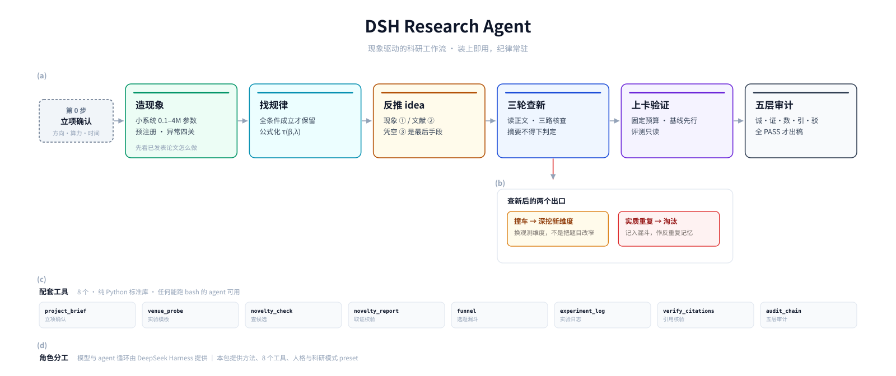

<div align="center">

# DSH Research Agent

**搭载于 DeepSeek Harness 的科研 agent** —— 选一个模式，人格与纪律常驻，不用等它想起来加载 skill。

[](LICENSE)
[](../../releases)



</div>

---

## 为什么单独做一个 DSH 版

普通的 skill 靠 agent 自觉加载：任务一忙、判断一偏，纪律就没进场。这个包解决的是**可靠性**——把方法论和人格装进 DSH 的 agent preset，选「科研模式」开新会话，纪律就在系统提示里，不依赖任何一次"要不要加载"的判断。

## 它包含什么

| 组件 | 内容 | 作用 |
|---|---|---|
| skill | `assets/ai-research-workflow/` | 方法论 + 8 个零依赖脚本 |
| agent preset | `research-preset/` | 选模式即成科研 agent，纪律写进系统提示 |
| 人格 | 科研侦探 | 好奇但克制、证据至上、失败当排除线索 |
| 自动循环 | 见 [AUTO_MODE.md](AUTO_MODE.md) | 用 goal + schedule 拼无人值守循环 |

## 工作流长什么样

第 0 步**立项确认**（方向 / 算力 / 时间 / 目标，落盘成 `PROJECT_BRIEF.md`）→ 造现象（先看**已发表论文**怎么做实验，不限顶会）→ 找规律 → 反推 idea → 三轮查新（只读摘要不得下判定）→ 上卡验证 → 五层审计。撞车不等于全灭：换观测维度可能翻出新预言。

完整方法论、8 个工具的用法、以及这些规则的实战来源，见主仓 **[ai-research-workflow](https://github.com/zhuowenzhang288-web/ai-research-workflow)**。

## 安装

```bash
# skill + 8 个脚本
install_bundle /path/to/dsh-research-agent
# 科研模式（agent preset）
install_bundle /path/to/dsh-research-agent/research-preset
```

装好后新开 session，在模式里选「科研模式」。

## 分工

引擎（模型 + agent 循环 + 工具执行 + 记忆）由 DeepSeek Harness 提供；这个包装进去的是**方法、工具、人格、模式**。换成别的 harness，方法论本体仍然可用——那部分是跨平台的。

## 目录

```
index.js                  在 ctx.skills 上注册 skill
cordis.patch.yml          挂载本插件
research-preset/          科研模式 preset 声明
assets/ai-research-workflow/  SKILL.md + scripts/
docs/architecture.svg     架构图（脚本生成，勿手改）
```

## License

MIT
